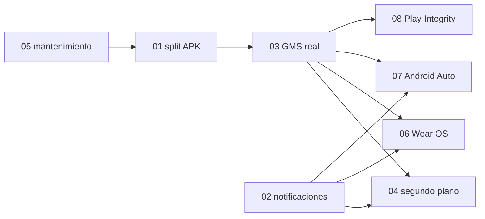

# Roadmap de la fase 1

Base: veredicto de la fase 0 ([veredicto.md](../fase0/veredicto.md)) y decisiones
ADR-0004 (GMS real) y ADR-0005 (Android Auto y Wear OS).

## Dispositivos de prueba

| Dispositivo | Uso |
|---|---|
| Móvil con Android 16 (ROM china, sin GMS) | Objetivo principal |
| Móvil con Android 17 (ROM china, sin GMS) | Objetivo principal |
| OPPO CPH2841, Android 16, ROM EEA con GMS | Referencia y comparación |
| Huawei Watch GT Runner 2 (vía Huawei Health) | Spec 02 |
| Reloj Wear OS (pendiente de llegar) | Spec 06 |
| Coche o head unit con Android Auto | Spec 07 (por confirmar) |

## Dependencias

## Hitos

| Hito | Contenido | Criterio de salida |
|---|---|---|
| **M1. Motor limpio** | 05 (parte bloqueante) y 01 | Gmail y Play Store clonados de un sistema con GMS abren dentro del box en Android 16 y 17. CI verde |
| **M2. Notificaciones** | 02 | NotifProbe pasa e y f: nombre de app y perfil, icono, tags, respuesta por broadcast y por servicio. Llega al Huawei GT Runner 2 |
| **M3. Spike de GMS real** | 03, tarea de spike | Decisión documentada: GMS real viable o no en Android 16 y 17 de ROM china. Si no, ADR para volver a microG |
| **M4. Cadena crítica** | 03 completo y 04 | Pasos a–f del plan de pruebas en verde en Android 16 y 17 con WhatsApp y Gmail. Mensajes en menos de 1 minuto a los 60 minutos de inactividad |
| **M5. Wear OS** | 06 | Reloj emparejado con la app compañera del box y notificaciones de WhatsApp del box en el reloj; o conclusión documentada de inviabilidad |
| **M6. Android Auto** | 07 (spike) | Conclusión documentada con evidencias; si es viable, spec de implementación |
| **Transversal** | 08 | Nivel de Play Integrity medido en cada hito a partir de M3 |
| **M7. Interfaz nueva** | 09 | Rediseño completo de la UI heredada del upstream (feedback del propietario: "la UI es feísima"). Puede empezar en paralelo a M2–M4, porque no toca el motor |

M2 no depende de GMS y puede avanzar en paralelo a M1 y M3.

## Estimación (días de desarrollo, borrador)

| Spec | Spike | Implementación | Total | Confianza |
|---|---|---|---|---|
| 05 mantenimiento | — | 10 (6 bloquean M1) | 10 | media |
| 01 split APK | 1 (diagnóstico) | 12,5 | 13,5 | media |
| 02 notificaciones | incluido | 14,5 | 14,5 | media-alta |
| 03 GMS real | 10 (corte el día 5) | 17 (25–35 con imprevistos) | 27–45 | baja |
| 04 segundo plano | incluido | 18 | 18 | media |
| 08 Play Integrity | — | 5–6 | 5–6 | media |
| 06 Wear OS | 5,5 | 26–36 | 31–41 | baja (~35 % de que sea viable) |
| 07 Android Auto | 5,5–6 | sin base hasta el spike (25–60+) | — | muy baja (por cable 10–20 %, solo DHU 25–35 %) |

Hasta M4 (cadena crítica: 05 + 01 + 02 + 03 + 04): unos **83–101 días**.
Con 06 y 08: unos **119–148 días**. Android Auto aparte.

Estas cifras suben respecto al veredicto de la fase 0 (46–64 días con microG) por
tres motivos:
- el GMS real;
- la verificación en Android 16 y 17;
- los spikes de Wear OS y Android Auto.

Decisiones pendientes: [PENDIENTES.md](PENDIENTES.md).

## Reglas de ejecución

- Cada tarea termina con un commit pequeño, su verificación descrita en el mensaje y la
  CI en verde.
- Las pruebas en dispositivo las ejecuta el propietario. Las tareas indican qué lanzar
  y qué evidencia devolver (`scripts/fase0/diag.sh`).
- Los APKs de Google nunca entran en ningún repo. Ver
  [fuentes-gms.md](../investigacion/fuentes-gms.md).
